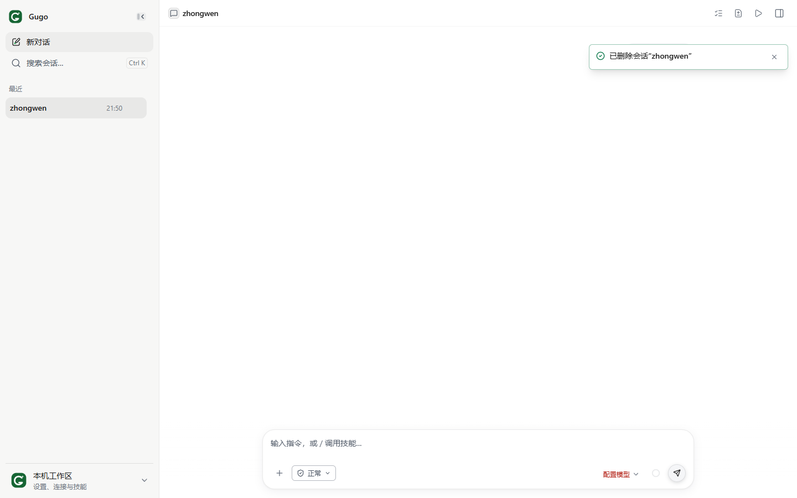
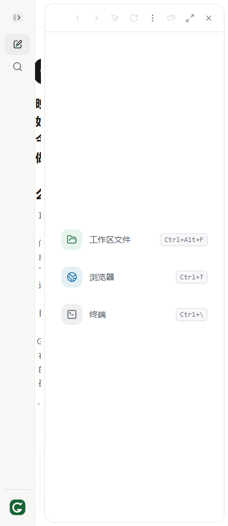

# Gugo 二次审查：修复边界与新增问题

审查依据：`docs/HANDOFF_2026-10-13.md`；源码基线 v0.11.72 / HEAD `b5698be`。

本报告不改写 2026-10-12 的历史记录，也不把已经修复的缺陷重新计作未修复。没有修改业务代码。

## 1. 结论

上一轮修复有实质效果：1024px 下打开工作台，聊天区已从 264px 恢复为 400px；用量页请求版本保护、Dock unsubscribe、单一主地标、本机身份文案、会话重命名和未配置模型提示均已落地。

**新问题集中在修复的边界：新加的产物策略熔断越过了“输出交付”边界；新加的重命名和删除确认没有完整覆盖输入法及异步失败；缓存 unknown 的修复仍漏掉部分上报；布局修复解决了正常窗口预算，但窄屏仍可把聊天区压到几乎不可用。**

本轮确认 5 个实现/交互问题，另确认 2 个交接文档问题。优先修纯只读任务误停和删除假成功。

## 2. 方法和验证范围

- 先读完整交接和 AGENTS，再检查 `2c9284f..b5698be` 的改动及真实 consumer。
- 重跑 16 个相关测试文件：**199 项通过，0 失败**。
- `npm run lint`、`npm run typecheck`、`npm run audit:functions -- --check` 均通过。类型检查仍是现有契约与 protocol pilot 范围，不等于整个 JSX 已严格类型检查。
- 用隔离 SQLite、临时工作目录、Edge Headless 和当前 Vite 源码验证布局、重命名和删除交互。没有读取 `.env` 内容或真实模型密钥，没有调用真实模型。
- 产物熔断复现使用合成 DOCX、真实 `readFileTool` 和真实 `runToolsLoop`；模型响应是确定性注入，不是线上模型结果。
- 输入法复现使用浏览器的 compositionstart / isComposing Enter 事件，不是人工使用 OS 输入法录屏；证明的是当前事件处理行为。
- 删除失败复现注入 HTTP 409，并沿现有 session mutation dispatcher 路径运行；不是删除真实会话。
- 按交接线索，以 `better-sqlite3` 的 `readonly:true, fileMustExist:true` 打开真实 `server-data/app.db`，只输出 usage/事件聚合，未输出提示词、文件正文、身份 token 或密钥，未导入会自动迁移数据库的运行时入口。
- 用外部临时故意失败测试验证 runner 退出码。这个 sentinel 失败是预期结果，不属于上面 199 项产品回归，也没有加入仓库测试目录。

未做全量 1138 文件回归、真实模型评测、完整 Electron 安装包和手机入口验收。当前默认 React `/#/chat` 界面的窄屏缺陷，不等于独立 `public/mobile.html` 也有相同缺陷。

## 3. 本轮问题总表

| 编号 | 优先级 | 问题 | 证据 |
|---|---|---|---|
| R01 | P1 | 只读文档分段读取被“产物交付策略”误熔断 | 真实文件读取 + 模拟模型驱动真实循环，已复现 |
| R02 | P2 | 中文输入法组合期间 Enter 提前提交重命名 | 浏览器事件复现 |
| R03 | P1 | 删除失败仍弹“已删除”成功提示 | 浏览器模拟 409，已复现 |
| R04 | P2 | 窄屏打开右面板仍可把聊天区压到 10px | 当前源码浏览器布局实测 |
| R05 | P2 | 只报告缓存写入时仍把未知缓存读取计作浪费；界面措辞却当成确定计费 | 纯函数复现 + UI 文案确认 |
| D01 | P1（运维文档） | 交接建议无条件删除 `server-data/` | 文档确认，未执行 |
| D02 | P2（交接准确性） | “runner FAIL 也返回 0”与当前代码和实测相反 | 故意失败 sentinel 的实际退出码为 1 |

优先级是修复建议，不代表全部问题同等影响默认 Windows 桌面配置。每项触发条件如下。

## 4. R01：只读输入检查被误当成不可交付输出

### 位置

- `server/adapters/fsFileTools.js:68-84`：对读取的 Office 文件附加生成产物格式校验结果。
- `server/services/loop/artifactFormatRejections.js:17-43`：按 path/code 计数，两次触发停止。
- `server/services/loop/runtime-createOutcomeRecorder.js:513-523`：对工具 outcome 无条件调用这个计数器，没有检查当前任务是否需要文件交付，也没有验证路径是不是本轮目标产物。

### 触发条件

读取既有 DOCX，文件中包含安全输出 allow-list 不接受的部件，例如普通 `word/settings.xml`。文本提取本身成功；同一文件用不同 offset 分段读两次。

用户要求明确是：

> 只读操作：分别读取 source.docx 的第一段与第二段，最后用文字总结，不要创建或改动任何文件。

临时 DOCX 只有两段文字和一个空 settings 部件，没有宏或脚本。

### 实际结果

真实 `readFileTool` 返回：

```json
{
  "ok": true,
  "text": "Section one",
  "formatValidated": false,
  "code": "ARTIFACT_FORMAT_ACTIVE_CONTENT_FORBIDDEN",
  "policy": true
}
```

第二次读取也成功返回另一段文字，但循环结果变为：

```json
{
  "toolRuns": 2,
  "incomplete": true,
  "noProgress": true,
  "reason": "artifact_format_policy_blocked",
  "missingRequirements": ["deliverable_artifact"]
}
```

返回 text 里甚至已有正确的文字总结，机器终态却标成未完成，并要求一份用户没有请求的交付文件。

### 根因

**“这份输入不允许作为生成产物发布”不等于“无法阅读这份输入并完成只读任务”。** 计数器只看格式拒绝码和路径，没有区分输入资料与本轮输出，也把分段读取算作重复生成尝试。

当前 `artifactFormatPolicyStop.test.js` 验证的是修改文档背景任务，不能证明纯只读任务的正确性。

### 修复方向

- 保留 Office 输出安全策略，不通过放宽安全 allow-list 掩盖这个问题。
- 将交付熔断限定为当前任务所要求、且确实在生成/验证的目标产物。
- 单纯读取输入得到的格式警告，不应消耗输出重试预算，更不能制造 `deliverable_artifact` 要求。
- 用“只读成功、有格式警告、两次不同分段读取、最终文字总结”补行为测试；对未请求文件的任务也检查机器终态。

## 5. R02：重命名缺少输入法组合保护

位置：`src/components/leftRail/SessionList.jsx:217-236`。

新输入框对所有 `event.key === 'Enter'` 都直接 `commitRename()`，没有检查 `isComposing`、nativeEvent 或 229 keyCode。

复现：

1. 开始重命名。
2. dispatch compositionstart，输入组合草稿 `zhongwen`。
3. dispatch `key='Enter', isComposing=true, keyCode=229`。

结果：

```json
{
  "editing": false,
  "requests": [{"title": "zhongwen"}],
  "title": "zhongwen"
}
```

本应给输入法确认候选字的 Enter，提前关闭编辑器并发送 `/rename`。对中文主界面，这是比圆角或字距更重要的使用体验问题。

项目已有 `src/pages/ChatSplit/chatComposerKeyGuard.js` 判断这类事件，可以复用已有原则，而不是重新猜输入法行为。补 composing Enter 不提交、compositionend 后 Enter 只提交一次的测试，并检查 Escape 在组合期间的行为。

现有重命名测试验证了普通 Enter、Escape、空白和重复 blur，不覆盖 composition 事件。

## 6. R03：删除结果还没确认，成功提示已经发出

位置：

- `src/components/LeftRail.jsx:79-84`
- `src/store/useSessionMutationDispatch.js:11-23`
- `src/store/sessionServerSync.js:287-298,362-365`

`confirmDelete()` 当前行为：

```js
dispatch({ type: 'DELETE_SESSION', payload: session.id })
toast.success(t('nav.deletedSession', { title: session.title }))
```

但这里的 dispatch 是带远程同步的 dispatcher。它可能返回异步操作，失败时保留会话、记录 warning、返回 false；外层没有等待结果。

### 已复现

将临时会话的 DELETE 请求模拟为 HTTP 409 `SESSION_ACTIVE`：

- 会话行仍然在列表中；
- 页面仍然能打开原对话；
- Toast 显示 **“已删除会话‘zhongwen’”**；
- 没有相应的用户可见删除失败反馈。



默认本机模式同样通过服务端 Session 管理，不能把这当作仅多用户部署的问题。

建议等待 mutation 成功才显示成功提示；失败时显示明确原因、保留可重试入口。弹窗应有 busy 状态，避免重复确认。如果使用乐观删除，反馈和撤销也必须与实际提交一致，而不是提前宣布成功。

## 7. R04：布局修复有效，但窄屏模式没有完成

位置：

- `src/lib/chatLayoutBudget.js:73-83`
- `src/pages/ChatSplit/rightPanes/RightPaneGrid.jsx:103-106`
- `tests/unit/ChatLayoutBudget.test.js` 的面板宽度下限测试。

本轮首先确认旧问题已修：

| 视口 | 左栏 | 右侧区域 | 聊天区 |
|---|---:|---:|---:|
| 1024px | 280px | 344px | **400px** |

但右区域始终保留 320px 最小宽度，窄屏左栏仍占 60px，没有切换为抽屉/覆盖层。因此：

| 视口 | 左栏 | 右侧区域 | 聊天区 |
|---|---:|---:|---:|
| 768px | 60px | 320px | 388px |
| 640px | 60px | 320px | **260px** |
| 390px | 60px | 320px | **10px** |



当前测试甚至把“chat column absorbs the deficit”当作预期。这说明不是预算计算偶然错，而是窄屏布局策略未解决：侧面板有可读下限，主任务区却没有可用性下限。

触发范围：当前 React 主工作台的窄视口、小浏览器窗口或较高页面缩放。常规 1024px 及以上窗口已修复，不能继续用旧截图说它完全没修。独立移动入口未在本轮验证。

建议宽度不足时右面板转抽屉或替换主区域；明确哪些模式能同时展示几块区域，再用实际元素几何验收，不只测 clamp 算术。

## 8. R05：unknown 修复仍漏掉“只上报缓存写入”

位置：`shared/modelCacheStats.js:28-30,87-96`。

新的 `reportsCacheUsage()` 判断：

```js
cacheHitTokens 已知 || cacheCreationTokens 已知
```

但 detectCacheMiss 随后仍将缺失的 `cacheHitTokens` 转成 0。缓存写入已知，不能证明缓存读取已知。

复现以一个已报告 8000 缓存读、10000 输入 tokens 的前序请求为基线：

| 当前请求 | 当前估算 |
|---|---|
| `promptTokens:10500`，没有任何缓存字段 | 0 次 miss，**此分支已修复** |
| `promptTokens:10500, cacheCreationTokens:0`，没有读字段 | **10000 tokens 浪费，1 次 miss** |
| `promptTokens:10500, cacheCreationTokens:2000`，没有读字段 | **10000 tokens 浪费，1 次 miss** |

这属于支持多 Provider/网关的契约边界，**没有在当前 Mimo 真实样本里复现**：该样本不报告缓存写字段。

此外，新加 UI 文案：`src/i18n/domains/usage.js:25,56`，声称这些 tokens “本可命中缓存却被重新计费”。算法只比较输入 token 数和 read 数，并没有证明实际字节重叠、有效缓存资格或计费事实。即使读数已知，`cacheWaste` 仍是启发式估算，不应作为确定账单展示。

建议 miss 计算要求本次 read 数确实已知；写入和读取保留独立 observation 状态；UI 用“估算可能重复处理的输入”并展示适用样本/限制。后续三层诊断属于管道建设，不应把没有实施新面板本身算成实现 bug。

### 真实缓存事实复核

只读数据库聚合结果，排除 `usage-report-*`、`usage-owner-*`、model-a/model-b 夹具后：

| 模型 | completed usage 样本 | 报告缓存读的样本 | 缓存读 tokens / 总输入 tokens | 仅已上报样本的加权读占比 |
|---|---:|---:|---:|---:|
| mimo-v2.5 | 92 | 85 | **67.34%** | 71.92% |
| mimo-v2.6-flash | 57 | 57 | **84.23%** | 84.23% |

两个模型都没有缓存写入样本。这确认了交接中的主要事实：**没有发送原生 `cache_control` 不能推出缓存不生效，端点的自动前缀缓存确实在报告 reads。**

67.34% 与 71.92% 也提醒：总输入占比和已测量样本命中占比不是同一个指标；未报告的 7 个调用不能被悄悄定义为实际 0 命中。这里没有发起新模型请求，也不拿历史样本当当前版本的成功率评测。

## 9. 交接文档需要纠正的两处

### D01：不能在真实仓库无条件删 `server-data/`

交接“环境坑”写：

> 每次换配置先 `rm -rf server-data/`。

当前目录确实包含真实数据库，交接自己也说它有真实使用记录。这个建议缺少“隔离测试 checkout / 临时数据目录”的限定，会让接手人删除真实会话、任务、授权等本地状态。目录里还可能有凭据密钥；如果清除后恢复的只是 DB，凭据也可能无法解密。并不需要知道此目录具体存了哪些秘密，才能确认无条件删除是危险指导。

本轮未执行删除。正确建议应是新建独立 APP_DATA_DIR/APP_DB_PATH，或在备份、确认范围后使用与历史代码版本匹配的数据库副本。schema 不兼容不能作为删除真实数据的默认理由。

### D02：runner 的退出码说明与当前版本相反

交接说“FAIL 也返回 0”。当前 `scripts/run-tests.js:535` 明确：

```js
process.exit(failed ? 1 : 0)
```

外部临时 sentinel 故意 `assert.fail()`，通过该 runner 调用，实测：

```json
{
  "exitStatus": 1,
  "signal": null,
  "finalLine": "[run-tests] final result: FAIL (1 final failure(s))"
}
```

因此不能将“退出码恒为 0”作为 runner 缺陷或操作约定。如果上一次观察到 0，应检查命令是否经管道、日志打印或外层 harness 丢失了原退出码；这属于当时执行链路待定位，不能反过来修改当前 runner。

## 10. 已反证/已修复的问题，不再重复报

- 正常 1024px 布局预算：实测已修。
- 用量页旧响应覆盖新响应：request version 已有相关测试并通过；本轮没有报告同一问题仍未修。
- Dock unsubscribe 丢失：已保存退订函数，并在 effect cleanup 同时清理 timer 和已建立的订阅。
- 嵌套主地标：修复相关测试通过。
- 本机身份伪邮箱和模型未配置引导：界面已有清晰文案。
- 会话缺少重命名和原生 confirm：已改；本轮报的是新增动作中的输入法与提交结果问题。
- 无 cache_control 所以没缓存：被真实 usage 反证。
- 同批读操作成功后清空普通连败判词：与 guard 计数语义一致，不列作 bug。
- 用户明确只读却被拒绝写入/Shell：正确安全边界，不因“命令看起来无害”就放开。
- 三层缓存面板未做：是未建设的能力，不等于当前既有功能失效。

## 11. 建议处理顺序

1. **R01**：让文档输入警告与输出交付熔断分离；把纯只读真实读取路径补入回归。
2. **R03**：成功反馈必须等待实际 mutation 成功，失败可见。
3. **R02**：复用输入法组合保护，补候选确认与组合结束测试。
4. **R04**：补窄视口布局模式，不靠主聊天区承担全部空间亏空。
5. **R05**：完整区分读、写、未上报，并把估算文案从确定计费事实降为有条件诊断。
6. 立即限定 D01 的运维指导并纠正 D02；不应通过改 runner 去迎合错误交接描述。

当前项目的门禁能力仍然强；这批问题说明下一轮需要增加**边界组合测试**：只读输入 × 输出安全、中文输入法 × 行内编辑、远程拒绝 × 成功提示、窄视口 × 并列面板、部分 usage × 统计估算。单个 happy path 通过不足以覆盖这些交叉状态。

## 附：现场保护与交付

只新增本报告与 `docs/review-evidence/2026-10-13/` 截图。保留原有未跟踪的交接、旧报告和旧截图，没有 commit/push，没有重置工作树，没有删除真实数据或修改模型配置。隔离复现脚本和日志位于系统临时目录 `gugo-review2-rTGKXb`。截图全部是隔离样例，不是用户真实对话。

## 12. 授权后的修复状态（2026-10-13，工作树未提交）

以下是后续实现记录，不改变上文审查时的基线和复现事实。

| 问题 | 当前处理 | 验证 |
|---|---|---|
| R01 | 仅请求中的产物生成器或实际修改债务对应路径参与交付策略熔断；源文件读取警告不计入 | 真实 DOCX 分段只读、有输出要求但源文件未修改、生成失败与修改后读回边界测试通过；输出 allow-list 未放宽 |
| R02 | 行内编辑和菜单共享输入法组合判断；组合 Enter/Escape 不提交，组合完成后普通 Enter 只提交一次 | 组件回归和隔离浏览器通过 |
| R03 | 等待实际删除结果后才提示成功；防重复提交、失败保留重试；等待窗口可以收起，但不撤销服务端请求 | 延迟响应、409 拒绝、成功重试和收起等待窗口测试通过；失败/未知只说“未能确认” |
| R04 | 可用宽度不足时覆盖式显示，复用焦点围栏、背景 inert、Esc/返回对话；保持同一工具树挂载 | 390/640/768/1024px 浏览器通过，跨宽窄模式草稿和节点身份保持测试通过 |
| R05 | 未知缓存读数不再被缓存写入字段冒充；统计文案明确为估算，未报告样本不计入 | partial usage、显式零、读写独立回归通过，中英文同步 |
| D01 / D02 | 交接顶部加纠正，危险删除建议和错误退出码说明保留为已撤回历史 | 未删除真实数据，未修改 runner 去迎合错误描述 |

### 实际验证记录

- 最终定向：10 个测试文件，57 项通过。
- 最终离线评测：71 项通过（确定性评测，不是真实模型成功率）。
- lint、debt、i18n 检查、字典键检查、依赖清单、typecheck、复杂度审计和生产构建通过。构建产物在隔离临时目录，未覆盖原 `dist/` 或 `release/`。
- 布局浏览器复验：1024px 聊天区 400px、并排右区域 344px；768/640/390px 的聊天区分别保留 708/580/330px，右区域独立覆盖，不占聊天宽度。截图为本目录新增的 `fixed-layout-*.png`。
- 全量 1142 文件首次扫描的原始结论是 **FAIL**：旧布局源码断言失败，以及 `mobileKeysUi.test.jsx` 的英文/i18n 夹具失败。
- 布局断言更新为新布局契约，且有额外组件/浏览器行为验证；原失败 100 文件批次完整重跑通过（929 项）。移动页文件单独重跑通过，但首次 i18n 失败的稳定性原因尚未完全定位；未改动其生产代码或放宽断言。
- 没有把原始全量 FAIL 改写成 PASS，也没有再声称完成一次从头全绿的全量运行。完整日志与批次选择清单保存在系统临时目录 `gugo-fix-Osv7SW`。
- 原生 Anthropic 离线夹具原先只接受系统提示字符串；现在显式验证 short 缓存块的完整结构和 none 模式的字符串，不改变生产缓存策略。

### 使用与剩余限制

本轮没有 commit、push、打包或发版。使用源码运行时，需要重启后端；生产网页或桌面开发实例还需在项目中重新构建前端。真实模型、安装包、长期内存/帧率和移动页夹具稳定性仍不在本轮已通过结论内。
