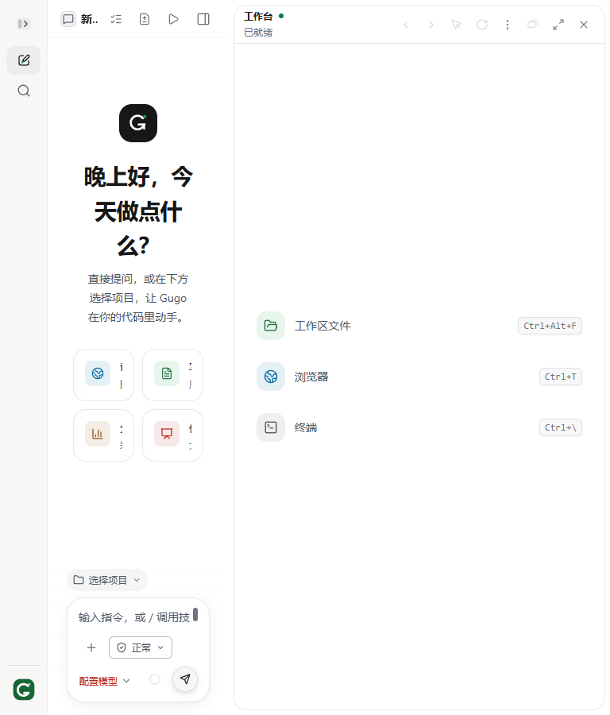
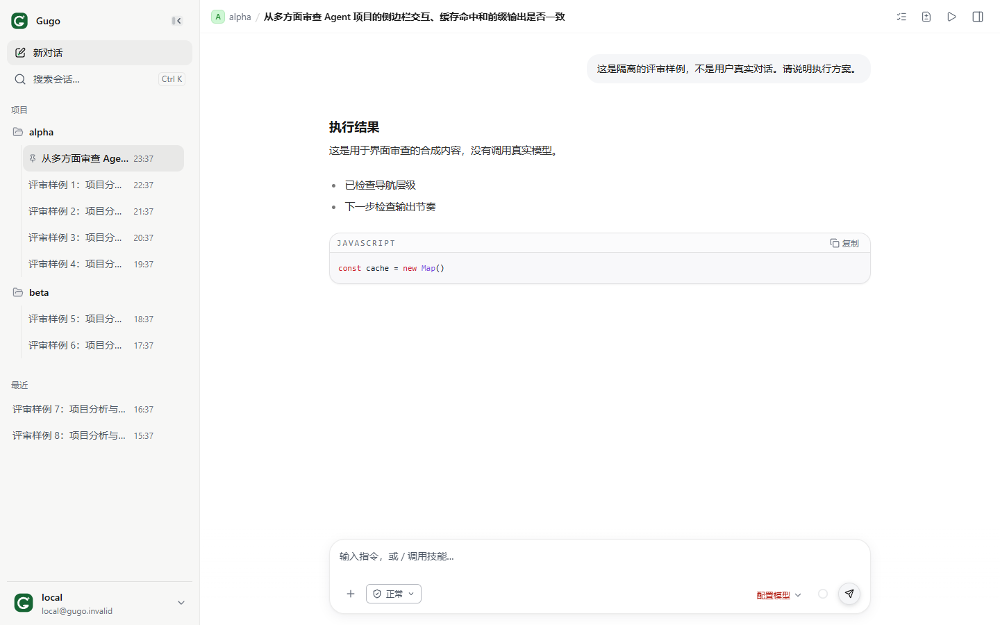
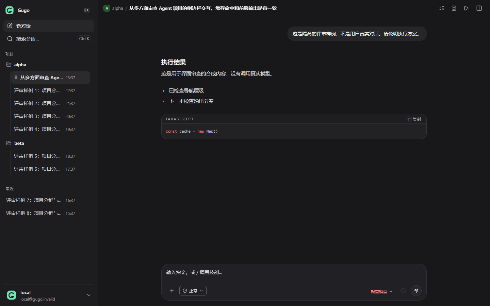
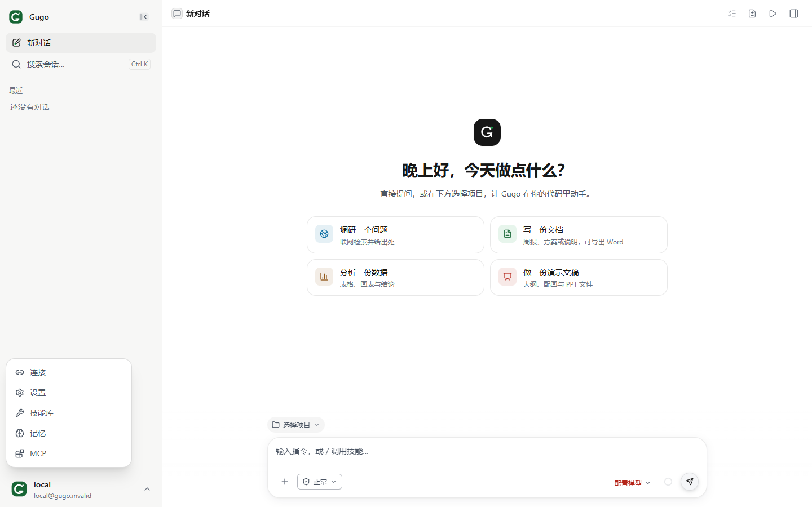
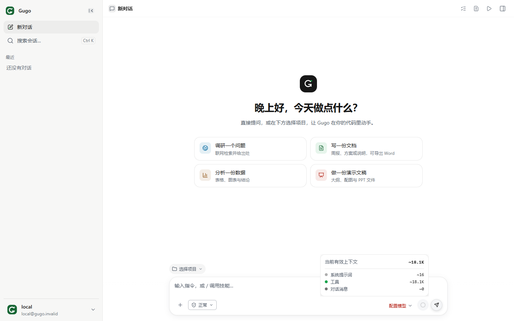

# Gugo 深度审查：产品体验、侧边栏、缓存与输出

审查基线：`package.json` v0.11.72，Git HEAD `2c9284f`。审查开始时工作树干净。

## 1. 结论先行

**Gugo 已经不是一个“聊天界面加几个工具”的薄壳。可信执行、权限、流式协议、恢复、文件交付、缓存适配都有实质实现。但工程防护的成熟度，高于用户体验整合的成熟度。**

界面并不缺少审美：默认白色主题克制，暖纸主题和暗色主题有明确色彩角色，侧边栏、输入框与代码块形成了相对统一的视觉语言。主要问题不是“换一个更漂亮的颜色”，而是：

1. 三栏布局没有共享空间预算，打开工具面板会把核心聊天区挤坏。
2. 用量统计存在异步竞态，缓存浪费估算存在 unknown/zero 混淆。
3. 简化导航时把关键能力藏得太深，产品看起来比实际能力弱。
4. 防止假完成的文本缓冲机制，没有完全转化成容易理解的等待体验。
5. 测试强于契约防回归，弱于真实布局、性能与人机流程验收。

不建议立即大改主题、增加炫酷动画或继续堆功能。**先修布局与统计，再优化导航和输出节奏。**

## 2. 审查方法、实测范围与限制

### 已做

- 阅读产品约束、架构入口、侧边栏及其控制器、对话渲染、输入框、右侧面板、PromptCompiler、缓存适配、前缀指纹、wire 诊断、用量聚合、模型请求循环和相关测试。
- 用当前源码启动独立 Vite 开发实例，使用独立临时 SQLite、工作目录和 Edge Headless 浏览器配置。
- `GUGO_LOAD_DOTENV=0`；没有读取项目 `.env` 内容，没有加载真实模型密钥，没有使用真实会话数据库，没有发起真实模型评测。
- 浏览器实际查看空会话、9 个合成会话和 2 个项目分组、会话菜单、账户导航菜单、上下文弹层，以及 1440、1024、768px 视口。
- 用浏览器注入确定性延迟响应，复现用量页请求竞态。此项是模拟网络行为，不是上游服务实测。
- 用纯函数输入复现缺失缓存计数被归类为浪费的问题。

### 验证结果

| 验证 | 结果 | 含义 |
|---|---|---|
| 19 个定向测试文件 | 196 项通过，0 失败 | 覆盖侧边栏、搜索竞态、缓存 usage、前缀稳定、原生缓存适配、流式进度、前置讲解、验证边界等 |
| `npm run lint` | 通过 | 零 warning 门禁通过 |
| `npm run typecheck` | 通过 | 当前契约与 protocol pilot 范围通过，不等于全部 React JSX 已严格类型检查 |
| `npm run audit:functions -- --check` | 通过 | AST 解析错误 0，规则下复杂度违规 0 |
| 当前源码生产构建 | 通过 | 输出到独立临时目录，没有覆盖项目 `dist/` |
| 当前浏览器布局与交互 | 部分问题已复现 | 详见下文 |

**未做：全量 `npm test`、全量离线评测、真实模型成功率/缓存命中率基准、Electron 安装包真机体验、屏幕阅读器测试、帧率或内存曲线基准。**

截图中的会话内容为明确标记的合成样例，不是用户真实数据；主题对照通过页面主题属性切换获得，不是设置页主题切换流程测试。浏览器结果可以用于判断 React 界面，但不能代替 Electron 原生文件选择器、标题栏、更新、桌宠和系统托盘验收。

## 3. 优先级总表

P1：优先修复，影响核心操作或数据可信度。P2：下一轮修复，影响长期体验、可访问性或能力发现。P3：测量后渐进优化。

| 编号 | 优先级 | 问题 | 证据等级 |
|---|---|---|---|
| F01 | P1 | 右侧面板挤压聊天区，未兑现最小可读宽度 | 浏览器已复现 + 调用链确认 |
| F02 | P1 | 用量页旧请求覆盖新时间范围 | 浏览器模拟慢响应已复现 |
| F03 | P1 | 未上报缓存计数被估算为缓存浪费 | 纯函数已复现 |
| F04 | P2 | Dock 订阅清理丢失 | 源码确认，未量化泄漏规模 |
| F05 | P2 | 主地标嵌套、局部无障碍语义不完整 | DOM 与源码确认 |
| F06 | P2 | 关键功能隐藏在“local 账户”菜单，导航语义弱 | 界面实测，产品判断 |
| F07 | P2 | 长标题快速失去识别度，会话管理动作不足 | 合成会话截图与菜单确认 |
| F08 | P2 | 未配置模型的首屏引导过弱 | 无密钥隔离实例实测，产品判断 |
| F09 | P2 | 缓存/前缀诊断已实现，但用户看不到完整解释 | 前后端 consumer 追踪确认 |
| F10 | P2 | 前置讲解缓冲仍可能形成长等待与突然整段出现 | 源码和定向测试确认机制；真实时延待测 |
| F11 | P3 | 长会话与高速流式重算路径需要性能基准 | 源码风险，未证明实际卡顿 |
| F12 | P3 | 通用控件复用不足，视觉测试不覆盖实际空间预算 | 当前结构与已复现问题对照 |

本轮没有发现并复现足以归为 P0 的严重安全事件；这不等于完成了全仓安全审计。

## 4. 已确认的实现问题

### F01：三栏各自保留聊天空间，却没有扣除左栏

位置：

- `src/pages/ChatSplit/rightPanes/useRightRegionLayout.js:16-42`
- `src/pages/ChatSplit/rightPanes/RightPaneGrid.jsx:94-99`
- `src/pages/ChatSplit/ChatSplitView.jsx:122-123`
- `src/components/leftRail/useLeftRailWidth.js:16-43`

右区域上限使用 `viewport - MIN_CHAT_WIDTH`，其中 `MIN_CHAT_WIDTH = 400`，但没有减去左侧 rail 的实际宽度。左栏和右栏都按整个窗口计算自己的空间。聊天区则 `min-w-0`，最终承担两侧挤压。

实测：打开右侧工作台后：

| 视口 | 左栏 | 右区域 | 实际聊天区 |
|---|---:|---:|---:|
| 1024px | 280px | 480px | **264px** |
| 768px | 60px | 480px | **228px** |

768px 下欢迎标题被拆成多行，四个建议卡片文字被严重挤压，输入框工具区换行，顶栏标题截断。不是主观审美问题，而是实际空间分配错误。桌面窗口缩小或系统缩放也会遇到相同的 CSS 视口问题，不应仅当作手机问题。



建议：

1. 由共同父容器/ResizeObserver 提供主区域可用宽度，统一计算左右区域预算。
2. 预算应包含 rail、聊天区、右区域、分隔条、padding；不能只修改某一侧常数。
3. 空间不足时右面板切成抽屉、覆盖层或单区域切换，而不是继续压窄聊天区。
4. 验收使用真实 bounding box：打开工作台、预览、diff，以及拖宽左栏/右栏后，聊天区仍满足约定宽度，或明确进入窄屏模式。

### F02：用量页时间范围存在请求竞态

位置：`src/components/settings/SettingsUsagePanel.jsx:71-96`。

`load(key)` 返回后直接 `setReport(next)`，没有 AbortController、request sequence 或“是否仍是当前 key”的校验。时间范围变化会触发多次请求，最后返回的响应不一定是最后选择的范围。

复现：

- 点击“最近 7 天”，模拟请求延迟 500ms，响应为 7 个回合。
- 30ms 后点击“全部”，模拟请求延迟 40ms，响应为 99 个回合。
- 最终“全部”按钮 `aria-pressed=true`，页面却显示 **“共 7 个回合”**。

这会损害 Token 和缓存统计的可信度，而且很难让用户意识到数字是旧范围的数据。你已经在会话搜索里解决了同类问题，可以复用相同的“最新请求拥有写入权”思路。

建议：请求编号或取消机制；响应绑定范围；切换时有加载标识；刷新请求也进入同一排序机制。补 slow-old / fast-new 的组件行为测试。

### F03：缓存浪费估算把 unknown 压成 zero

位置：`shared/modelCacheStats.js:26-29,72-85,108-117`。

`tokenCount()` 将缺失字段和非法值返回为 0。只要之前的请求报告过缓存活动，后面的请求即使没有 `cacheHitTokens` 字段，也可以被视为 0 命中。

复现输入：

```js
computeCacheWaste([
  { timestamp: 1000, modelName: 'test',
    usage: { promptTokens: 10000, cacheHitTokens: 8000 } },
  { timestamp: 2000, modelName: 'test',
    usage: { promptTokens: 10500 } }, // 本次缓存读数未知，不是报告了 0
])
// { missedTokens: 10000, missedCost: 0, missCount: 1 }
```

这与 `RequestCacheUsage` 界面及 usage normalization 的“未上报不等于 0”原则不一致。实际 Provider、网关或流式 trailer 可能间歇性缺失缓存字段，不能根据上一请求就认定这一请求完全未命中。

另外：

- `CACHE_TTL_MS` 固定为 5 分钟，不能普遍解释 OpenAI、Gemini、本地 KV cache 或已设置 Anthropic 1h 的请求。
- `min(previousPrompt,currentPrompt)-cacheRead` 只能估计重复输入量；相同长度不等于相同内容。
- 缩小超过 10% 被用作上下文重写的替代信号，可能漏计，也可能误判。
- “unknown cost” 返回数值 0，机器 consumer 容易把它当成确实没有额外费用。
- `localUsageReportService.js` 的聚合字段不包含 `cacheCreationTokens`，虽然单请求 UI 会展示缓存写入；统计口径没有完全统一。

建议：保留 unknown；明确样本覆盖率；未测量样本不进入 miss 计数；TTL 来自有效 endpoint/cache policy；结合真实 prefix/tools/config/compaction 诊断。估算应叫“疑似重复输入/潜在缓存损失”，不要当作计费事实或确定因果。

### F04：Dock 订阅不会在正常卸载时解除

位置：

- `src/pages/ChatSplit/chatSplitView/ChatRightPanels.jsx:59-63`
- `src/pages/ChatSplit/dock/dockStore.js:38-40`

当前 effect：

```js
const timer = setTimeout(() => subscribeDock(setDockState), 0)
return () => clearTimeout(timer)
```

timer 执行后，`subscribeDock()` 返回的 unsubscribe 没有保存。卸载只清理已执行的 timer，不能从模块级 `listeners` Set 删除订阅。往返聊天与其他路由会保留旧组件 listener。

这是源码可确认的生命周期缺陷；本轮没有做长时间内存测量，因此不声称它已经造成明显卡顿。建议清理 timer 和已建立的 subscription，或使用 `useSyncExternalStore`，并覆盖 mount/unmount/remount。

### F05：可访问性仍有结构性漏项

- `src/App.jsx:78` 有外层 `<main>`；`ChatSplitView.jsx:122` 又通过 `mainAs="main"` 创建内层 `<main>`。浏览器 DOM 实测有两个嵌套主地标。
- 左栏 resize handle 的名称复用了 `workbench.resize`，读作“拖动调整工作台宽度”，与所操作区域不一致：`LeftRail.jsx:134`。
- 上下文圆环声明 `aria-haspopup="dialog"`，对应弹层是普通容器，没有完整的 dialog/焦点语义；需要选择正确的 disclosure 或 popover/dialog 模式，而不是只增加属性。

值得保留的已有工作：侧栏抽屉支持 inert 背景和焦点围栏；会话菜单支持键盘导航、关闭及焦点回归；触屏动作扩大到 44px；减少动画偏好有明确处理。不能据少数漏项否定这些实现。

## 5. 侧边栏与视觉质感

### 5.1 当前做得好的地方

- 展开状态约 280–320px 自适应，可手动调到 220–480px；折叠为 60px。
- 项目分组、会话置顶、时间展示、完整标题 tooltip、hover 操作、右键菜单是实际可用功能。
- 行高约 38px，分组与选中行使用轻背景；长列表的密度方向合理。
- 白色/暖纸/暗色主题有语义色、代码高亮和五档字体体系。
- 视觉主体是内容，不是满屏高饱和标签与悬浮动画。这个方向适合长期工作的桌面 Agent。





### 5.2 F06：极简导航降低了功能可发现性

展开菜单实际显示“连接 / 设置 / 技能库 / 记忆 / MCP”，入口却是左下角的 `local / local@gugo.invalid`。

位置：`src/components/leftRail/AccountArea.jsx:22-45`。

问题不在“本机免登录”，而在界面仍使用账户/邮箱外观承载工作区级导航：

- 新用户自然把它理解成个人信息，而不是能力中心。
- 看不到技能、记忆、连接入口时，容易把 Gugo 当成普通聊天器。
- 伪邮箱暴露了内部身份表示，削弱面向用户的完整感。
- 菜单下还有功能路线和命令入口，但用户需要记住它们在哪里；不等于功能完全不可达。



建议：本机模式用“本地工作区 / 设置与工具”替代伪账户语义；保留少量固定、带名称的能力入口或一个明确“更多”入口。不要把全部功能重新堆满侧栏，也不要为了简洁而让用户只能猜头像。

### 5.3 F07：长标题识别度不够，会话管理偏薄

9 个合成会话中，项目内约二十字标题已经大量截断。固定保留时间、操作列，再叠加项目缩进与置顶图标，标题获得的空间明显小于侧栏整体宽度。

位置：`SessionList.jsx:188-207`；`LeftRail.css` 的 session row/open/time 样式。

已有完整 tooltip 和 aria-label，**没有丢失标题数据**；不足是扫描效率：多个同前缀标题仍难以快速区分。默认宽度再增加一点也不解决重名/近似名问题。

实际会话菜单只有“置顶/取消置顶、归档、分叉、删除”，没有重命名动作。删除使用原生 `confirm()`：`LeftRail.jsx:69`，安全上保留确认是对的，但视觉和撤销体验与应用内其他操作不一致。

建议：

- 提供重命名；长标题采用可选两行模式或 hover 时让时间/动作列让位。
- 可区分项目路径的次级信息，避免仅文件夹末段同名造成歧义。
- 重要会话有更易查找的收藏/置顶视图；是否全局置顶应作为产品决策，不应误改现有项目内排序。
- 归档给轻量反馈和可撤销；删除保留明确确认，可渐进换为统一对话框。
- 若添加执行状态，仅显示“运行/待用户确认”等轻量提示，不把失败日志污染成长期会话标题徽章。

### 5.4 F08：模型未配置时，首屏仍像已经可以开工

隔离实例没有模型配置：欢迎区展示“调研、写文档、分析数据、做演示文稿”，真正的阻碍只在输入框底部小字“配置模型”和禁用发送按钮上。

已有 readiness 检查，不能说“没有前置校验”；不足是核心状态不突出。建议首屏就显示紧凑的“先连接模型”卡片，同时保留输入和附件草稿。没有必要强制增加首次启动向导；只需让当前为什么不能开始、下一步点哪里更清楚。

### 5.5 质感问题应怎样修

当前不是缺一个品牌字体，而是跨页面控件实现容易漂移。当前统计：238 个 JSX 文件，约 560 处 `<button>`；没有全局通用的 `components/ui/Button` 层，设置页已有局部 primitives，但其他区域仍自行拼装。

建议先收敛 Button、IconButton、Field、MenuItem、Popover、EmptyState 的行为和尺寸，再逐步迁移高频页面。不要把所有高度、圆角、间距强行统一成一个值；统一的是语义与状态规则，不是取消合法差异。

**旧审查文档中“几乎没有按下态、没有全局焦点反馈、指定字体完全没加载”的结论不能直接套用：当前 `index.css:2636-2650` 已提供通用按下态和焦点轮廓，字体配置也已改为系统/serif 栈。** 主题正文语义色的对比度测试本轮通过；但这不证明所有 opacity 组合、实际背景和用户自定义颜色都满足完整 WCAG。

## 6. 缓存命中与前缀：实现扎实，解释仍欠缺

这里必须分开四个概念，避免“缓存命中率”把不同事情混在一起。

| 层次 | 当前实现 | 能说明什么 / 不能说明什么 |
|---|---|---|
| 本地 PromptCompiler 缓存 | `promptCompilerCache.js`，4 类 block，每类最多 64 条 LRU，稳定 fingerprint | 复用本机编译文本；不等于上游 KV cache 命中，也不直接证明费用下降 |
| 上游缓存策略 | 工具 canonicalization、动态工具后置、OpenAI owner-scoped hashed cache key、Anthropic ephemeral/1h 标记 | 增加缓存复用机会；不保证具体 Provider 真正命中 |
| 应用与 wire 前缀诊断 | `promptPrefixFingerprint.js`、`modelWireDiagnostics.js`、`runtimeContextDiagnostics.js` | 能比较应用稳定块及最终 wire 指纹；不等于模型实际分词或缓存账单 |
| 实测 usage 与聚合 | `RequestCacheUsage.jsx`、usage normalization、local report | 单请求能区分读、写、普通输入和未上报；统计/浪费估算还有前述缺口 |

### 应保留的优点

- 工具 JSON 键排序与工具名称排序有真实稳定化实现。
- 动态工具追加在基础工具集合后，减少中途插入导致的前缀重排。
- OpenAI cache key 按 owner/provider/model 隔离且 hash，不直接暴露身份。
- Anthropic 长/短缓存与兼容网关 header 有明确协议边界，不乱发到其他 Provider。
- 应用 `pre_compaction` 与适配后 `wire` 诊断区分清楚；没有把本地 hash 相同冒充缓存已命中。
- 单请求 UI 对未知 cache read 不显示虚构的 0%。相关测试通过。

### F09：这些信息没有形成面向用户的诊断闭环

`turnEventDispatch.js:54-70` 将应用/wire diagnostics 留在 message meta，但普通界面没有相应的完整解释面板；`SettingsUsagePanel` 展示总量、按模型/会话及 hit rate，不展示 `cacheWaste`、样本覆盖率、TTL、前缀/工具变化原因。

用户看到一个低命中率，却无法判断：

- 该 Provider 是真实报告 0，还是根本没报告？
- 是首次调用、缓存过期、切模型、工具变化、Skill 加载，还是上下文压缩？
- 当前数值是最近一次请求、整个 Turn，还是整段时间？
- 低命中是否伴随真实首字变慢？

建议做一个默认折叠的“请求诊断”，按层显示：本机编译命中 / 上游报告 / 前缀变化 / 工具变化 / 有效缓存策略；高级用户才展开 hash。因果不确定时用“可能”，不要把每次低命中都归罪于 Prompt。

### 空会话的工具上下文值得测量

无消息的首屏上下文面板显示约 **18.1K 估算 tokens**，几乎全部来自工具，系统提示词约 16。这是客户端估算，不是上游实测输入，也不能证明每个真实请求都发送了全部静态候选。



它至少说明前台诊断需要更明确地区分“候选工具估算”和“本次真实发送集合”。后续应比较真实 wire toolCount、promptTokens、首字时延和缓存 reads，再决定是否缩短 schema 或加强按需工具发现。优化不应绕过权限或减少任务必需能力。

## 7. 前置讲解、流式输出与执行可信度

“前缀”有两个可能含义：上节讨论 Prompt 可缓存前缀；本节讨论用户看到的“我先检查……然后执行……”这类前置说明。

### 当前行为是什么

位置：`server/services/loop/runtime-runModelRequest.js:48-58,123-188,236-255`。

1. 只要当前授权工具集合中可能调用修改型工具，答案资格未满足时，文字先进入 `heldNarration`。
2. 真实工具调用开始时，释放已缓存的说明文本；之后符合条件的文字继续流式。
3. 没有工具调用的回答可能直到模型请求结束、证据审查通过后，才整段发布。
4. 源码交付保护、代表性文件读取和交付证据检查会进一步限制发布。

`tests/liveNarrationBeforeToolCall.test.js` 已验证“说明在工具执行前出现，而且只出现一次”。这比完全隐藏说明好。但测试也明确要求：第一段说明必须晚于“工具参数开始”事件。因此它**不等于模型一输出说明就立即显示**。

### F10：防假完成正确，但时间感仍可能不自然

- 模型先长篇解释再开始调用工具：用户仍只能看等待状态，之后说明突然出现。
- 仅因候选工具里存在修改型工具就影响文本策略，可能使本轮最终纯文本回答也以整段方式出现；这是保守设计，应测量其影响，不应直接当成执行错误。
- compatibility 文本型工具调用不一定有原生调用开始事件，释放时机需要单独测量。
- 最终报告替换轨迹视图、工具列表折叠等会改变阅读位置，需要实时/结束两态的截图与滚动锚点验收。

建议保留“结果未经验证不得当成完成”的门槛，但区分三种输出：

- **宿主生成的阶段状态**：可马上显示，例如“请求模型”“准备工具参数”“运行验证”，不透露私有推理。
- **经过结构化标记的公开工作说明**：按明确契约发布，不能把任意模型文字直接认定为安全说明。
- **最终完成报告**：继续等待证据门控。

应测量 TTFT（模型首个有效输出）与 TTFV（用户首个可见进展）的差值。界面慢有时不是网络，而是信息被宿主暂扣；当前只显示总耗时，难以解释这个差距。

### 已有执行能力不能被忽略

活动状态已区分连接、等待首输出、生成参数、idle、重试、压缩及压缩降级；工具运行由 durable timeline 展示，避免重复卡片。文件交付、未完成报告、结果未知与暂停/取消有单独表示。验证测试覆盖不同 verifier family、目标归属、后续修改导致旧验证失效、基础设施失败与项目失败的区别。

这些是产品可信度优势。改善 UX 应围绕“更早看见真实阶段、更清楚读到阻碍”，而不是为了看起来流畅就让模型未验证的“完成”先出现在屏幕上。

## 8. 性能、工程门禁与产品能力边界

### F11：长会话性能已经有防护，但仍缺实测

已有：`messageWindow.js` 默认只渲染 80 条，支持较早消息窗口和定位，不能再笼统说“深历史全部渲染”；MarkdownRenderer 也有 memo，工具 stdout 有 buffer。

剩余风险：

- `ChatSplitView.jsx:106` 在 render 中估算全部消息与工具上下文，没有该层缓存。
- `ChatMessages.jsx:71` 每次更新映射可见消息，MessageRow 不是 memo 组件；其内部需要计算文件引用、timeline、报告分段与 agent rounds。
- `turnEventDispatch.js:289-297` 每个 assistant delta 更新状态；活动文本变化仍需 Markdown 解析/高亮。Markdown 的 memo 不能阻止内容真实变化时重算。
- 左栏仍对完整 session 列表过滤、分组、排序和 map，没有类似消息窗口的虚拟化。

不据此声称已发生严重卡顿。建议建立 1000 会话、80 条可见消息、长代码块、连续工具输出、高速 delta 的 benchmark；量化输入延迟、长任务、滚动卡顿、保留内存，再决定按帧合并 delta、memo 或增量解析。文字缓冲不能丢终态或破坏事件顺序。

当前构建的较大块包括 ChatSplit 约 630KB、AppLayout 约 464KB、I18nProvider 约 332KB（均为压缩前）；路由已 lazy，不能把所有 chunk 相加当首屏体积。应从实际网络 waterfall 和依赖链测首次打开、设置返回和预览加载。

### F12：门禁很强，但不能代替体验门禁

当前 lint、typecheck、复杂度检查、定向测试均通过，实际仍出现 264px 聊天区与用量竞态。部分 UI regression/visual 测试检查源码结构、token 和颜色数值，无法捕捉面板组合后的最终几何。

建议新增：

- 浏览器截图：三主题 × 1440/1280/1024/768px × 工作台/预览/diff 组合。
- 几何断言：最小内容宽度、按钮不被遮挡、popover 不超出屏幕。
- 行为断言：打开/关闭/切路由/切会话/重连/取消/待审批。
- 无密钥首屏与模型配置返回路径。
- 订阅清理与异步 latest-request-wins。
- 流式开始/等待/参数/工具运行/验证/终态的一致性和阅读锚点。

### Agent 成功率与安全结论的边界

当前 starter live suite 是 11 个受控修复任务。本轮没有执行真实模型评测，不能从 196 项通过推出“真实复杂任务成功率很高”，也不能据这些任务直接判定达到或落后于某个商业 Agent。

本地免登录、BYOK、免费开源不是不足。默认 host Shell 是信任边界选择，不等于 OS 沙箱：只读浏览与获授权执行必须分开评价。不要为了修 UX 自动扩大目录、Shell、MCP 或插件权限，也不要把 Docker 变成所有 Windows 用户必装的隐含前提。

## 9. 建议实施顺序与验收

### 第一批：准确、可读、可恢复

1. 修 F01 共享布局预算；窗口变窄时明确转换右面板形态。
2. 修 F02 请求竞态。
3. 修 F03 unknown/zero、样本覆盖和估算命名。
4. 修 F04 subscription 清理及 F05 主地标。

验收：本报告两个浏览器复现和缓存纯函数复现不再成立；相关行为测试新增；现有缓存/验证/恢复测试不回退。

### 第二批：让真实能力容易找到

1. 本机身份文案产品化，给设置/技能/连接清晰入口。
2. 会话重命名、长标题可读策略、归档反馈。
3. 未配置模型时提供显著但不阻塞草稿的下一步提示。
4. 请求诊断面板分层展示缓存、前缀、实际工具和真实 usage。

验收：让第一次接触的人不依赖文档，找到模型配置、项目选择、技能、文件预览与执行阻碍；用观察而不是开发者直觉评估。

### 第三批：输出节奏与性能

1. 建立 TTFT/TTFV、完成时延及取消响应指标。
2. 覆盖慢模型与长工具参数、compatibility 协议、报告结束重排。
3. 长会话/大量会话 benchmark 后做必要的流式合批、memo 和窗口化。
4. 逐步收敛高频 UI primitives，不做全仓视觉大爆炸式重构。

**最终判断：值得继续打磨，方向不是推翻重做。Gugo 当前最需要的是把已有的可信执行能力，变成用户始终看得懂、点得到、等得住、恢复得了的产品体验。**

## 附：交付与现场保护

本轮只新增这份报告和 `docs/review-evidence/2026-10-12/` 下的评审截图，没有修改业务源码、真实配置或真实会话数据。所有运行及模拟样例使用临时目录。定向测试不是全量回归，浏览器模拟不是生产上游数据，报告中的风险项已明确标记。
